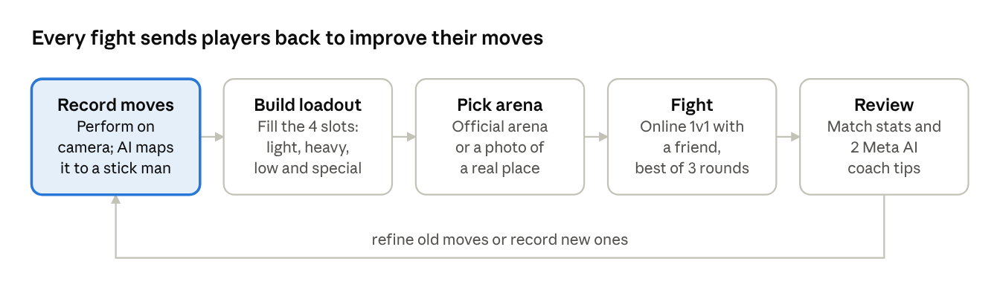
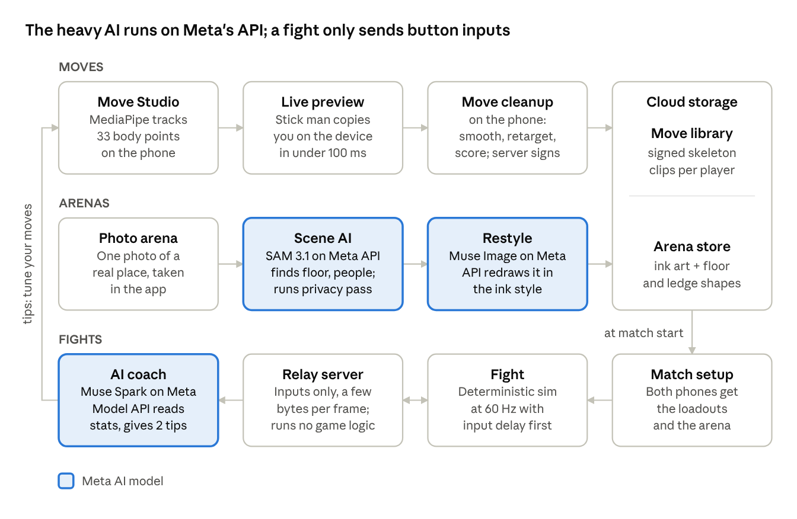
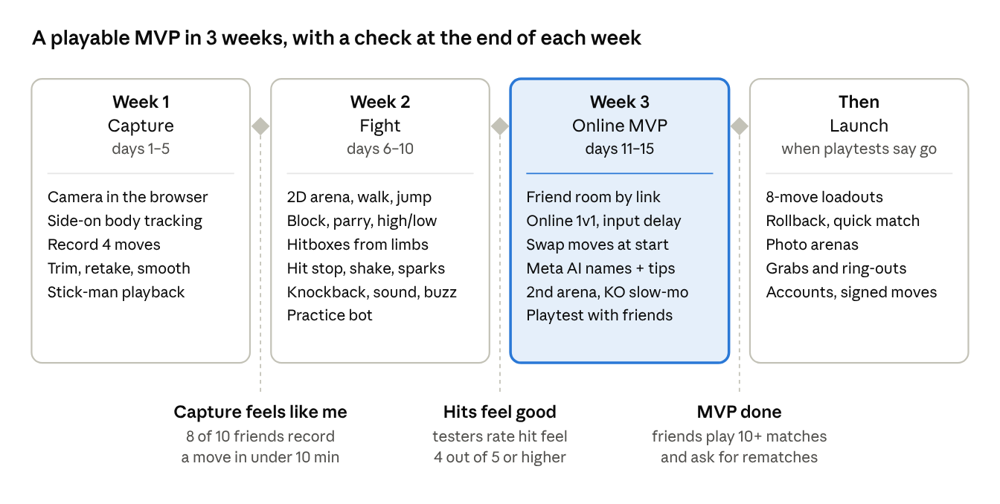

# SticXcape PRD — Motion-Capture Stick Fighter

Nov 3, 2026 · @Felix · exported from the [live doc](https://claude.ai/artifact/92awHCKr9eSbJmi1h5ofwj)

## TL;DR

SticXcape is an online stick-figure fighting game where your own body writes the move list. You perform punches, kicks, dodges and taunts in front of your phone's camera, and body-tracking AI on the phone (Google's MediaPipe) turns each one into a stick-man move, while Meta's AI names your moves and coaches you. You then fight other players' custom stick men inside arenas made from photos of real places.

Three pillars carry the game:

- **Your moves** — every fighter's moveset is motion-captured from a real person, so no two players fight alike.
- **Your turf** — arenas are made from photos of real rooms, parks and streets.
- **Your rivals** — online 1v1 with friends, plus Meta AI tips after every match.

The MVP ships on phones (iPhone and Android) as a web app built in 3 weeks, with recorded movesets and online 1v1; no headset or extra hardware needed. Fights use on-screen buttons only.

This file is the product PRD: what we build and why. The engineering detail is split into three files: [Frontend PRD](02-frontend-prd.md) for the phone web app, [Backend PRD](03-backend-prd.md) for the services, and [Integration PRD](04-integration-prd.md) for the contracts and end-to-end tests that join them.

## Game name

The game is called **SticXcape**, chosen on 2026-11-03. Tagline: *Your moves. Your turf. Your fight.*

SticXcape sounds almost the same as [Stixcape](https://bl4s9.itch.io/stixcape), a small itch.io puzzle game from December 2024. Before launch, run a trademark search (USPTO, EUIPO), check the App Store and Google Play, and grab the domain and social handles.

**Other names considered**

| Name | What it signals | Watch-outs |
| --- | --- | --- |
| Stickscape (earlier working title) | Stick fighters + arenas from real places | Also close to Stixcape |
| Home Turf | Fight on your own ground; leans on photo arenas | Common phrase, weak for search and trademark |
| Mimic Arena | The stick man copies your body | Mimic is used by many games; not checked |
| Shadowbox | You shadowbox; your stick man fights for real | Common word; not checked |
| Linebreakers | Fighters made of lines, breaking each other | Not checked |

## Vision, goals and non-goals

**Vision:** a fighting game where the way you actually move *is* your character, and anywhere you've been can be the stage.

**Why now**

- In fighting games everyone picks from the same roster; self-expression stops at skins. SticXcape makes the moveset itself player-made.
- AI body tracking now runs live on an ordinary phone: Google's MediaPipe tracks 33 body points, with rough 3D positions, right in the browser.
- Meta's hosted AI can find the floor in a photo and redraw it in any art style, so a snapshot of a real place becomes an arena with no GPU servers.
- Stick men hide tracking jitter, dodge the uncanny valley, and are cheap to render and send over the network. A shaky capture still looks good as a stick figure.

**MVP goals** (targets to validate in playtests)

1. A new player records a usable 4-move set within 10 minutes of first launch.
2. Online 1v1 fights between two custom movesets feel fair: no move type wins far more often than the rest with slot-based power.
3. Players can fight in 2 hand-drawn arenas; photo arenas of your own places follow at launch.
4. Matches run at 60 fps on a mid-range phone and feel responsive for friends in the same region; rollback for longer distances comes at launch.

**Non-goals**

- Realistic human graphics or face capture.
- Headsets or extra hardware: a phone is all a player needs.
- Esports-grade balance or tournaments at launch.
- Capturing anyone who hasn't agreed to be recorded.
- User scripting or modding of game code.

## Target players

The core player is 13–30, plays with friends, and wants to show off something about themselves. Four personas shape the design:

| Persona | Who they are | What they want | What we build for them |
| --- | --- | --- | --- |
| The Mover | Dancers, martial artists, athletes, gymnasts | Their real skill to matter in a game | Clean capture, KO slow motion, moves that look like them |
| The Couch Brawler | Groups of friends, party players | Silly moves, laughs, quick rounds | Friend rooms, taunts, instant rematch |
| The Creator | Streamers, TikTok/Reels creators | Weird arenas, signature moves | Photo arenas shared with friends |

Age gate: players under 13 are out of scope at launch (see Privacy).

## Core game loop and modes

A session is a loop: record moves, fit them into a loadout, pick an arena, fight, then review. The review is what brings players back to tune their moves.

Recording (highlighted) is what no other fighting game has; everything after it uses standard fighting-game structure.

**How you fight.** Your body only records moves; fights are played with on-screen buttons. A virtual stick and five buttons trigger your recorded moves. This keeps fights fair (every move is checked before the match), keeps online play light (only button presses travel) and lets people play anywhere, even sitting on a bus.

## Feature: Move Studio

Move Studio turns 1–3 seconds of real movement into a game-ready move in under a minute: capture it, clean it up, check it against physics, then score it for fairness.

### Capture flow

1. **Set up.** Prop the phone 2–3 m away with the whole body in frame. The app checks light, framing and clear floor space, and warns about furniture within arm's reach.
2. **Calibrate.** Hold a T-pose for 3 seconds. This is only used to scale the capture onto the standard stick-man skeleton.
3. **Perform.** A 3-2-1 countdown, then act out the move. Up to 5 takes per move; the app suggests the cleanest one.
4. **Preview.** An on-device tracker shows the stick man copying you right away.
5. **Process.** Cleanup runs on the phone: smoothing, foot-contact fixes and retargeting onto the standard skeleton. The video never leaves the phone; only the finished skeleton is kept.
6. **Physics check.** The move is replayed in a physics sim; joint angles and speeds beyond human limits are clamped.
7. **Score.** The game computes its frame data and applies the speed cap.
8. **Edit and save.** Trim, mirror left/right, adjust speed, name it, pick a trail colour, save to the Move Library.

Any recent iPhone or Android phone works. The rear camera gives the cleanest capture (prop it up and use the voice countdown); the front camera lets players watch themselves while they record.

### Loadout

A loadout is 8 combat moves plus a free taunt and victory pose. Walking, jumping, crouching, blocking, hit reactions and getting up are built in and the same for everyone; players can record an idle stance, which is cosmetic only.

| Slot | Moves | Examples |
| --- | --- | --- |
| Light attack | 2 | Jab, snap kick |
| Heavy attack | 2 | Haymaker, spinning back-fist |
| Low / sweep | 1 | Leg sweep, low kick |
| Special | 1 | Flying kick, cartwheel strike |
| Defense | 1 | Slip, roll, parry |
| Grab / throw | 1 | Hip toss, shove |
| Taunt + victory pose | free | Any move; no combat effect |

### Fairness: slots set the power

Each loadout slot has fixed power, so balance never depends on how a recording turned out. The recording decides how a move looks, where its hitbox travels and which height it hits; the slot decides its damage and timing.

| Slot | Damage | Startup (frames) | Recovery (frames) |
| --- | --- | --- | --- |
| Light | 5 | 6 | 10 |
| Heavy | 12 | 14 | 24 |
| Low | 8 | 10 | 18 |
| Special | 15 | 18 | 30 |
| Defense | 0 | 2 | 16 |
| Grab (launch) | 10 | 8 | 30 |

Starting values, tuned in playtests; a frame is 1/60 s.

- **Same body for everyone.** Every capture is mapped onto one skeleton size, so tall players get no extra reach.
- **Speed cap.** Joint speeds above a human-plausible limit are slowed, so speeding up a clip doesn't help.
- **Server-signed moves (launch).** The server validates and signs each move; clients can't edit move data.
- **Live capture only.** No importing gallery videos. This blocks edited clips and stops people from capturing someone else without consent.

### Requirements

| ID | Requirement | Priority |
| --- | --- | --- |
| MS-1 | Capture a move from one phone camera in an ordinary room | P0 · MVP |
| MS-2 | Live stick-man preview on the phone while recording | P0 · MVP |
| MS-3 | On-phone cleanup of a 3 s clip finishes in under 10 s | P0 · MVP |
| MS-4 | Every capture is retargeted to the one standard skeleton | P0 · MVP |
| MS-5 | Trim and retake | P0 · MVP |
| MS-6 | Default moveset for the practice bot and new players | P0 · MVP |
| MS-7 | Meta AI suggests move names | P0 · MVP |
| MS-8 | Mirror left/right and adjust speed by up to ±25% | P1 · launch |
| MS-9 | Jitter score with retake tips when a capture is too shaky | P1 · launch |
| MS-10 | Physics check clamps impossible joint angles and speeds | P1 · launch |
| MS-11 | Measured power budget instead of slot-based power | P2 · later |
| MS-12 | Full preset move library | P2 · later |
| MS-13 | Seated, upper-body-only capture mode | P2 · later |
| MS-14 | Auto-classify the move type | Cut |

## Smooth motion

Yes, moves will look smooth, because no raw capture ever reaches a fight. AI tracking from a phone wobbles a little every frame, feet slide and hidden limbs pop. SticXcape fixes this twice: the move pipeline cleans each move once, and the game blends between moves live at 60 fps.

### Cleanup in the move pipeline (once per move)

| Problem in raw capture | Fix |
| --- | --- |
| Jitter: joints shake slightly frame to frame | Smoothing filter tuned per joint: strong on the torso, light on fists and feet so strikes stay sharp |
| Low frame rate | Record at 60 fps where the phone supports it; otherwise 30 fps with in-between frames generated |
| Feet sliding on the floor | Foot locking: a planted foot is pinned in place |
| A limb hidden behind the body | Filled in from the frames before and after, guided by the body model's sense of likely poses |
| Limbs stretching or shrinking | Fixed bone lengths on the standard skeleton |
| Snapping at the start or end | Trimmed so each move starts and ends near the fighting stance |

Moves are stored as joint rotations rather than positions, because rotations blend smoothly. A capture that is still too shaky after cleanup gets a jitter score and a retake tip: more light, step back, or move a bit slower.

### Blending in the game (every frame)

- **Blend in and out.** A move fades in from whatever pose the fighter is in over about 4 frames, and back to stance over about 6. The blend counts toward startup, so frame data stays honest.
- **Procedural layers on top.** Head and torso turn to face the opponent, feet adjust to ledges and steps, and a subtle breathing idle keeps the stance alive.
- **Physics on hits.** Hit reactions mix the captured motion with the active ragdoll, so getting hit never cuts to a canned animation.
- **High-refresh screens.** Game logic runs at 60 Hz; on 90 or 120 Hz phones the drawing fills in between logic frames.
- **Smear frames.** On very fast swings the limb is drawn stretched for 1–2 frames, a classic animation trick that makes speed read as motion instead of a jump.

## Feature: Combat system

Fights are 2D side-view: the camera keeps both fighters in view. This keeps fights readable on a phone and works on every arena, including photo arenas.

### Bodies and hits

- Each limb is a capsule. During a move's active frames the striking limb becomes a hitbox; head, torso and limbs are hurtboxes.
- Stick men are physics-driven active ragdolls: they keep balance under small hits, stagger under heavy ones and fall past a threshold. Knockback grows with damage, so fighters can be knocked off ledges for a ring-out.
- A clean hit does full damage, a glancing hit (limb tip only) does half, and hitting an opponent during their startup frames is a counter-hit for 25% extra.

### Every move has a strength and a weakness

Two layers decide who wins an exchange. First, a triangle of action types: **strikes beat grabs, grabs beat blocks and parries, blocks and parries beat strikes.** Second, Move Studio reads each recorded move and tags it with traits on two axes. The move card shows the tags, so players learn matchups by reading their own moves.

| Trait (auto-tagged) | How it is detected | Strong against | Weak against |
| --- | --- | --- | --- |
| High | Strike lands at head height | Jumping opponents | Crouching (it whiffs overhead) |
| Mid | Strike lands at torso height | Crouching opponents | Standing block |
| Low | Strike lands below the knee | Standing block | Crouching block, jumps |
| Light | Recorded in a Light slot | Interrupts slow moves | Armored heavies; low damage |
| Heavy | Recorded in a Heavy or Special slot | Armor: absorbs one light hit | Punished hard if blocked or parried |

Every move gets one tag per axis, so a spinning heel kick might be High + Heavy: it shrugs off one light hit, but loses to a crouch or a well-timed parry.

### Parry

Every fighter has the same built-in parry: **tap** Block just before a strike lands instead of holding it.

- **Window:** 6 frames (0.1 s) after the tap. A standing parry stops highs and mids; a crouching parry stops lows.
- **Success:** the attacker staggers for 20 frames (30 against a heavy), long enough for a free counter, and the parrier's guard meter refills.
- **Miss:** a whiffed parry has 20 frames of recovery and takes counter-hit damage. Feints and delayed moves are the answer to players who parry everything.
- **Grabs can't be parried.**
- Players can record their own parry motion, but it is cosmetic: the window is the same for everyone.

### Meters and rounds

- **Health:** 100 per round.
- **Stamina:** spent by heavy and special moves, refills over time; stops spamming the strongest move.
- **Guard:** holding Block cuts damage by 80% but drains the guard meter; when it empties the guard breaks and the fighter is stunned for 40 frames.
- **Rounds:** best of 3, 60 s each. KO, ring-out, or more health at time-up wins.

### Controls

Fights use on-screen buttons only: a virtual stick under the left thumb and five buttons under the right (L, H, S, D, Block). Players can move and resize them.

| Action | On-screen input |
| --- | --- |
| Move, crouch, jump | Virtual stick |
| Light 1 / 2 | Tap L / stick direction + L |
| Heavy 1 / 2 | Tap H / stick direction + H |
| Low | Stick down + H |
| Special | S |
| Defense move | D |
| Block / parry | Hold / tap Block |
| Grab (launch) | L + H together |

### Requirements

| ID | Requirement | Priority |
| --- | --- | --- |
| CB-1 | 2D side-view fights with an auto camera | P0 · MVP |
| CB-2 | Capsule hitboxes driven by each move's active frames | P0 · MVP |
| CB-3 | Block and the built-in parry (same 6-frame window for everyone) | P0 · MVP |
| CB-4 | High, mid and low tags on every move | P0 · MVP |
| CB-5 | Deterministic simulation (needed for online play) | P0 · MVP |
| CB-6 | Grabs and throws | P1 · launch |
| CB-7 | Stamina and guard meters | P1 · launch |
| CB-8 | Active-ragdoll knockdowns and ring-outs | P1 · launch |
| CB-9 | Light and heavy traits shown on the move card | P1 · launch |
| CB-10 | Sidestep lane | P2 · later |
| CB-11 | Training mode showing hitboxes and frame data | P2 · later |
| CB-12 | Free-roam 3D fights in AR arenas | Cut |

## Game feel: making hits satisfying

A hit feels good when many small effects fire on the same frame it lands, scaled by how hard it was. SticXcape plans each effect for four moments (light hit, heavy hit, parry, KO), and adds a twist only motion capture allows: the direction of your real swing decides where the opponent flies.

### Hit feedback by moment

| Effect | Light hit | Heavy hit | Parry | KO |
| --- | --- | --- | --- | --- |
| Hit stop (both fighters freeze) | 3 frames | 8 frames | 12 frames | 20 frames, then slow motion |
| Hit stun (target can't act) | 12 frames | 20 frames | Attacker staggers 20 (30 vs a heavy) | None |
| Knockback | 0.2 m push | 1–1.5 m, can launch | Attacker pushed back 0.5 m | Full launch |
| Camera | Steady | Small shake and a quick zoom punch | Snap zoom on the parrier | Slow motion on the final hit |
| Visual | Small ink spark | Ink burst; struck limb flashes white; 1-frame impact flash | Bright ring flash and a PARRY pop-up | Inverted-colour impact frame |
| Sound | Light thud | Layered crunch and whoosh | Sharp metallic clang | Boom, then the music drops out |
| Phone vibration | Light tap | Strong buzz | Crisp double tap | Long rumble |

All values are starting points for playtests. Vibration works on Android only until there is a native app (see Look and sound).

### Knockback

- **Your real swing sets the direction.** The opponent flies along the striking limb's direction at contact: an uppercut launches up, a hook spins them sideways, a sweep takes the legs out. This is SticXcape's signature feel.
- **Strength grows with damage**, plus a little extra when the target is low on health, so ring-outs get likelier as a round goes on.
- Launch angle is capped at 70° so nobody gets juggled forever; every stick man has the same weight.
- **Knockdown and get-up (launch).** A downed fighter rolls left, rolls right or stands in place, with a few invulnerable frames, so nobody gets trapped in a loop.
- **Ring-outs (launch).** Being knocked off a ledge ends the round with a slow-motion fall.

### Combos without infinite loops

- A light move that hits can be cancelled into a heavy, so combos come naturally from recorded moves.
- Each extra hit in a combo deals 10% less damage (never below 50%) and gives less hit stun, so every combo ends.
- A hit counter (3 HITS) and labels like COUNTER, BLOCKED and WHIFF tell players exactly what happened.

### Damage you can read

- **Health bar with a trailing chunk.** Lost health first shows as a white chunk that drains away, so a big hit stays visible for a moment.
- Damage numbers are optional and off by default.

### Visual polish

- Trails and smear frames on fast limbs, in the player's chosen colour.
- Squash and stretch: limbs flex a little on impact and spring back.
- **Fair warning glow.** The striking limb glows faintly during a heavy move's startup, which makes parries learnable.
- Dust puffs on landings and footsteps.

### Feel in the hands

- **Input buffer.** A button pressed up to 6 frames early still counts, so moves come out when players expect.
- On-screen buttons click and give a light vibration the instant they are pressed.
- Swing whooshes scale with limb speed, so fast moves sound fast.
- Music builds in the final round and cuts out on the KO.

### Satisfying beyond the hit

- **One-tap rematch** and rounds under a minute.
- **Post-match stats.** Which moves landed, got blocked or got parried; the AI coach builds its tips from these.

### Fairness and comfort

- Hit stop freezes both fighters equally, so effects never change frame data or break the netcode.
- Screen shake, flashes and vibration each have a slider that goes down to off, for players sensitive to motion or flashing light.

### Requirements

| ID | Requirement | Priority |
| --- | --- | --- |
| GF-1 | Hit stop, shake, sparks, sound and vibration scaled by hit strength | P0 · MVP |
| GF-2 | Knockback direction taken from the striking limb at contact | P0 · MVP |
| GF-3 | KO slow motion | P0 · MVP |
| GF-4 | Combo damage scaling and hit-stun decay | P1 · launch |
| GF-5 | Comfort settings for shake, flashes and vibration | P1 · launch |
| GF-6 | Wall splat, ground bounce and ring-out fall | P2 · later |
| GF-7 | Visible wear on the stick man and ink that stays on the floor | P2 · later |
| GF-8 | KO cam replay from a dramatic angle | P2 · later |
| GF-9 | Move mastery cosmetics | Cut |

## Look and sound

Most of what players see and hear comes straight from their recorded motion: limb speed drives trails and whooshes, foot plants drive footsteps and dust, and the contact point places the hit spark. Hit timing and strength are tuned in Game feel; this section covers the stick man's look, the screen and the sound plan.

### The stick man

- **Built from 17 joints.** MediaPipe's 33 points are reduced to the head, neck and pelvis plus both shoulders, elbows, wrists, hips, knees, ankles and toes, then fitted to the standard bone lengths. Each fist is a small dot.
- **Ink lines.** Thick strokes with round ends and a slight brush taper. The head is a circle with a small notch showing which way the fighter faces.
- **Far limbs thinner and a shade darker,** so players can tell the near arm from the far one in side view.
- **Colour tells fighters apart.** You are always drawn in your chosen ink colour; your opponent gets a contrasting colour picked automatically.
- **A light outline around each fighter** keeps them readable on any background, including busy photo arenas.
- **Landscape only.** Recording and fighting both use landscape, which suits side-on movement.

### Movement players don't record

Recorded moves cover attacks, the defense move, the taunt and the victory pose. Everything else comes from a default set the team records with Move Studio itself, so it moves like the players' own recordings.

- **MVP:** idle stance, walk forward and back, crouch, jump (rise, fall, land), standing and crouching block, light and heavy hit reactions, KO fall.
- **Launch:** knockdown and get-up, active-ragdoll hit reactions, and players can record their own idle stance.

### The screen

- **Thin HUD.** Health bars with the trailing chunk at the top, the round timer and round dots between them, and pop-ups (PARRY, COUNTER, BLOCKED, WHIFF, combo count) near the fighters.
- **Buttons.** Virtual stick bottom-left and five buttons bottom-right, semi-transparent so fighters show through.
- **Camera.** Side view that pans and zooms to keep both fighters in frame, with a zoom punch on heavy hits and slow motion on the KO.
- **Arena behind the fight.** Official arenas are drawn in a muted ink wash. Photo arenas are restyled the same way and dimmed slightly during fights, so stick men always stand out.

### From motion to sight, sound and touch

| What happens | What you see | What you hear | What you feel |
| --- | --- | --- | --- |
| A limb moves fast | Trail and smear frames | Whoosh, louder and higher the faster the limb | Nothing |
| A foot plants | Dust puff | Footstep, louder on landings | Nothing |
| A strike lands | Ink spark at the contact point; struck limb flashes | Impact layered by hit strength | Tap or buzz by strength |
| A strike is blocked | Shield arc on the blocker | Dull thump | Light tap |
| A strike is parried | Ring flash and PARRY pop-up | Metallic clang | Crisp double tap |
| A strike misses | Trail fades; WHIFF pop-up | Whoosh only | Nothing |
| A KO | Inverted-colour impact frame, slow motion | Boom, then the music cuts out | Long rumble |

Limb speed and foot plants come from the cleaned-up recording, so a fast real kick looks and sounds fast. Vibration works in Chrome on Android, but iPhone browsers can't vibrate at all ([W3C report](https://w3c.github.io/vibration/reports/implementation.html)), so iPhone players feel hits only once a native app exists.

### Sound plan

- **Style.** Punchy ink-and-paper sounds (brush swooshes, thuds, cracks) and no gore sounds, matching the ink-never-blood look.
- **Source.** A licensed sound library plus a few custom sounds. Meta's Model API lists no sound or music generation, so audio is the one asset Meta AI doesn't make.
- **Variety.** Each impact plays with a small random pitch shift, so repeated hits never sound identical.
- **Music.** One fight loop for the MVP; a final-round layer and a menu track at launch. Music dips under big hits and cuts out on the KO.
- **Announcer.** The MVP uses text pop-ups with short stingers (ROUND 1, FIGHT, KO); recorded voice lines are parked.
- **Browser rules.** Browsers block sound until the first tap, so the title screen asks players to tap to start. A mute button is always on screen.
- **Mix.** Hits come first, then pop-up stingers, then music.

### Requirements

| ID | Requirement | Priority |
| --- | --- | --- |
| LS-1 | Stick man drawn from 17 joints in ink-style strokes | P0 · MVP |
| LS-2 | Your fighter in your colour; opponent in a contrasting colour | P0 · MVP |
| LS-3 | Far-side limbs thinner and darker | P0 · MVP |
| LS-4 | Light outline around fighters | P0 · MVP |
| LS-5 | Default movement set recorded by the team with Move Studio | P0 · MVP |
| LS-6 | Thin HUD and semi-transparent on-screen buttons | P0 · MVP |
| LS-7 | Whooshes from limb speed, footsteps from foot plants, layered impacts | P0 · MVP |
| LS-8 | One fight music loop, tap-to-start audio and a mute button | P0 · MVP |
| LS-9 | Final-round music layer and a menu track | P1 · launch |
| LS-10 | Separate music and effects volume; sounds pan with fighter position | P1 · launch |
| LS-11 | Photo arenas restyled in muted ink and dimmed during fights | P1 · launch |
| LS-12 | Players record their own idle stance | P1 · launch |
| LS-13 | Announcer voice lines | P2 · later |
| LS-14 | Vibration on iPhone (needs a native app) | P2 · later |

## Feature: Arenas

Players fight in two kinds of arena: hand-drawn official stages (MVP) and photo arenas made from a snapshot of a real place (launch). Photo arenas need no GPU servers: Meta's hosted AI does all the work.

**What the scanning tech is called.** Turning photos or video of a real place into a full 3D scene is called **3D scanning** or **photogrammetry**; the modern AI version is **Gaussian splatting**. It needs GPU servers to build every scan, so SticXcape uses **photo arenas** instead: one photo, understood and redrawn by Meta's hosted AI. Full 3D scans can come back later if players ask for them.

### Arena sources

| Source | How the player makes it | Under the hood | Phase |
| --- | --- | --- | --- |
| Official | Picks from a list | Hand-drawn by the team | MVP |
| Photo arena | Takes one photo of a real place | SAM 3.1 finds the floor, ledges and people; Muse Image redraws it in ink style (both on Meta Model API) | Launch |

### Photo arena pipeline

1. **Snap.** Take one landscape photo of a place, standing back so plenty of floor shows. An overlay shows where the fight line will run.
2. **Understand.** SAM 3.1 on Meta's Model API finds the floor, walls, tables, benches and steps, plus people, faces, licence plates, screens and documents.
3. **Privacy pass.** People are removed and faces, plates, screens and documents blurred before anything else happens. This step cannot be skipped.
4. **Restyle.** Muse Image redraws the cleaned photo in the game's ink style, so photos from any phone look like one game.
5. **Make it playable.** The floor becomes the fight line, tables and benches become platforms, drops become ring-out edges, and spawn points are placed.
6. **Check.** Photos with too little clear floor for a fight are rejected with a request for another shot.
7. **Share.** Private by default; can be shared with friends.

Target: under 2 minutes from photo to fight. No GPU servers of our own; each arena costs a few Meta API calls.

### Choosing where to fight

- **Friend rooms:** the room host picks the arena, an official one or a photo arena someone in the room made.
- **Quick match (launch):** a random official arena.

### Requirements

| ID | Requirement | Priority |
| --- | --- | --- |
| AR-1 | 2 hand-drawn official arenas | P0 · MVP |
| AR-2 | Room host picks the arena | P0 · MVP |
| AR-3 | 60 fps on mid-range phones in every arena | P0 · MVP |
| AR-4 | Photo to playable arena in under 2 minutes | P1 · launch |
| AR-5 | Mandatory privacy pass on every photo arena | P1 · launch |
| AR-6 | Ring-out edges and platforms | P1 · launch |
| AR-7 | Share photo arenas with friends | P1 · launch |
| AR-8 | Public arena browser with moderation | P2 · later |
| AR-9 | Arena nomination and random pick | P2 · later |
| AR-10 | Phone AR arenas on a real table or floor | P2 · later |
| AR-11 | Text-prompt arena generation | P2 · later |

## Feature: Multiplayer

The MVP is online 1v1 in private rooms with input-delay netcode, an AI opponent and cross-play between iPhone and Android. Rollback netcode and quick matches with strangers follow at launch.

### Modes

| Mode | Players | Phase |
| --- | --- | --- |
| Friend room | Invite link; up to 8 in a room, winner stays on | MVP |
| Practice bot | 1v1 against a bot using the default moveset | MVP |
| Quick match | 1v1 with a stranger of similar skill | Launch |

### How online fights stay smooth

- **Rollback netcode (launch).** Players send only their button inputs, a few bytes per frame. Both devices run the same deterministic simulation; when an input arrives late, the game rewinds and replays the last few frames. This is what modern fighting games use, and it is why moveset mode is the MVP: inputs are tiny and predictable.
- **Deterministic physics.** Fixed 60 Hz step and fixed-point maths so both devices always compute the same result.
- **Movesets swapped up front.** At match start each player receives the opponent's loadout through the relay (under about 50 KB; server-signed from launch), so no move data travels during the fight.
- **Budget:** at launch, 2 frames of input delay plus up to 8 frames of rollback, which covers about 100 ms of ping. The MVP uses 3 to 6 frames of input delay instead (see Integration).
- **Relay, not raw peer-to-peer.** Traffic goes through relay servers so players never see each other's IP address.

### Matchmaking and social

- Quick match (launch) pairs players on skill rating and ping (target under 100 ms).
- Friends list and invite links.
- Report and block from every result screen.

### Requirements

| ID | Requirement | Priority |
| --- | --- | --- |
| MP-1 | Online 1v1 in friend rooms by invite link | P0 · MVP |
| MP-2 | Input-delay netcode through a relay server | P0 · MVP |
| MP-3 | Cross-play between iPhone and Android | P0 · MVP |
| MP-4 | Practice bot using the default moveset | P0 · MVP |
| MP-5 | Match stats and 2 Meta AI tips after each match | P0 · MVP |
| MP-6 | Rollback netcode (smooth up to about 100 ms ping) | P1 · launch |
| MP-7 | Quick match with strangers | P1 · launch |
| MP-8 | Movesets signed and verified before every match | P1 · launch |
| MP-9 | Accounts and a cloud move library | P1 · launch |
| MP-10 | Replays and vertical clip export | P2 · later |
| MP-11 | Ranked with skill rating and seasons | P2 · later |
| MP-12 | 4-player party brawl | P2 · later |
| MP-13 | Ghost match against a friend's AI | P2 · later |
| MP-14 | Spectator mode | Cut |
| MP-15 | 2v2 tag team | Cut |

## Meta AI technology map

Meta's AI handles the language and image layer (move names, coach tips, arena art, moderation) and turning photos of real places into arenas. Body tracking uses Google's MediaPipe on the phone: free, instant, and no servers. Because Meta's hosted Model API runs Muse Spark, Muse Image and SAM 3.1, SticXcape needs no GPU servers of its own. Every license below must be confirmed by a lawyer before launch.

| Game feature | Tech | What it does in SticXcape | License / availability | Plan |
| --- | --- | --- | --- | --- |
| Body tracking (not Meta) | [Google MediaPipe Pose Landmarker](https://developers.google.com/edge/mediapipe/solutions/vision/pose_landmarker) | Tracks 33 body points live in the phone browser | Open source (Apache 2.0); runs on the phone, free | MVP |
| Coach tips and move names | Muse Spark on [Meta Model API](https://dev.meta.ai/docs/models.md) | Turns match stats into names and tips | Hosted by Meta | MVP |
| Arena art | Muse Image on Meta Model API | Helps draw the 2 official arenas; redraws photo arenas in ink style | Hosted by Meta | MVP for official art; launch for photo arenas |
| Photo arenas: floor, ledges and privacy pass | SAM 3.1 on Meta Model API | Finds floor, furniture, people, faces, plates and screens in a photo by text prompt | Hosted by Meta; SAM License allows commercial use with restrictions ([summary](https://roboflow.com/model-licenses/segment-anything-3)) | Launch |
| Nickname and taunt moderation | A moderation prompt on Muse Spark | Flags abusive nicknames and obscene taunt clips | Hosted by Meta (Llama Guard isn't on Model API) | Launch, when strangers meet |

### AI features players will see

- **Move namer (MVP).** Suggests a name and one-line description for each new move.
- **AI coach (MVP).** After a match it reads the stats (hits, whiffs, parries per move) and gives two concrete tips, e.g. that your heavy was parried 6 times so try delaying it.

## Technical architecture

Everything heavy runs on Meta's hosted Model API, so SticXcape needs no GPU servers of its own. Tracking and move cleanup run on the phone; Meta's API handles text, images and segmentation. The servers we do run are small: a relay for fights, plus storage for moves and arenas.

Moves and arenas flow left to right into cloud storage; a fight starts by downloading both from there, and the AI coach's tips send players back to Move Studio.

| Layer | Choice | Why |
| --- | --- | --- |
| App (MVP) | Phone web app in TypeScript, runs in Safari or Chrome | Ships in weeks; friends join from a link |
| App (later) | Unity for native iPhone and Android apps | Store presence, better performance, AR |
| Physics | Deterministic, fixed-point, 60 Hz | Both phones must compute the same fight |
| Netcode | MVP: input delay through a WebSocket relay; later: rollback | Simple first; rollback once longer distances matter |
| Body tracking | Google MediaPipe on the phone | Free, instant, video stays on the phone |
| Hosted AI | [Meta Model API](https://dev.meta.ai/docs/models.md): Muse Spark for text, Muse Image for art, SAM 3.1 for segmentation | No GPU servers to run; pay per call |
| Move format | Fixed-point joint angles plus frame data, server-signed at launch (see Integration) | Standard, small, tamper-evident |
| Arena format | Ink-style image layers + JSON (floor line, ledges, spawns, edges) | Small; loads fast on any phone |
| Replay format | Input log, a few KB per match | Re-simulates the whole fight exactly |

## Performance, safety and accessibility

The game must hold 60 fps on a mid-range phone, keep players physically safe while they record, and stay playable for people who can't or don't want to throw a kick.

| Area | Requirement |
| --- | --- |
| Frame rate | 60 fps on mid-range phones; smoother drawing on 90–120 Hz screens |
| Local input lag | Button press to screen in 3 frames (50 ms) or less |
| Capture speed | Live preview under 100 ms; finished move under 10 s |
| Photo arena speed | Playable arena under 2 min after the photo |
| Download size | Under 300 MB to install; arenas stream on demand |
| Uptime | Matchmaking and capture services 99.5% monthly |

### Physical safety

- **Clear-space check** before every capture: the camera measures free floor space and refuses to record if furniture or people are within reach.
- **Slow-motion recording.** Players can perform a move at half speed and let the game play it at full speed, within the speed cap. Safer for kicks and spins.
- **Phone on a stand.** The app asks players to prop the phone up rather than hold it while performing.
- Short safety tips on the first capture: shoes off or grippy shoes, no recording near stairs, glass or pets.

### Accessibility

- **A default moveset**, so recording is never required to play.
- On-screen buttons can be moved and resized, and a one-thumb layout is available.
- Hit, parry and trait colours that work for colour-blind players, plus sound cues for parries.
- Captions for the AI coach tips.

## Privacy, trust and safety

SticXcape handles two sensitive things: how people's bodies move, and what their homes look like. The default answer to both is to keep as little as possible, for as short a time as possible, and private unless the player chooses otherwise.

**Body data**

- How someone moves can count as biometric data under some laws (for example Illinois BIPA and GDPR). Treat skeletons as sensitive: explicit consent at first capture, never used to identify anyone, deleted on request.
- Capture video never leaves the phone: tracking runs on the device and only the finished skeleton is kept.
- Only the player may be recorded: if Move Studio sees a second person in frame, it pauses.

**Photo arenas**

- Photo arenas are private by default. The privacy pass (remove people, blur faces, licence plates, screens and documents) always runs.
- GPS and photo metadata are stripped; there is no map or location search.
- Photo arenas are shared only with friends; there is no public arena browser.

**Players and content**

- 13+ at launch, which keeps children's privacy law (COPPA) out of scope for v1.
- A moderation prompt on Muse Spark screens nicknames; Muse Spark also checks each recorded taunt clip and flags obscene ones.
- Report and block on every profile, arena and match result.

**Legal checklist before launch**

- [ ] Confirm commercial terms for every Meta model shipped (Meta Model API terms for Muse Spark, Muse Image and SAM 3.1)
- [ ] Keep non-commercial models (Meta Motivo, Sapiens v1) out of the shipping build
- [ ] Biometric consent flow reviewed for US states and the EU
- [ ] Trademark clearance for the final name
- [ ] Store policy review: App Store, Google Play

## Monetization

SticXcape is free while it proves itself: no shop in the MVP or at launch. Once players keep coming back, it will sell looks only, never power; the ideas are under Parked ideas near the end.

Meta API costs scale with photo arenas, so free players get a weekly allowance (for example 3) with more earned through play, not sold.

## Success metrics

The beta succeeds if new players record a moveset fast and keep coming back to fight. Targets below are starting points for the closed beta.

| Metric | Target |
| --- | --- |
| New players who save 4 moves in their first session | 60% |
| Median time to first 4-move set | 10 min or less |
| Captures usable on the first take | 80% |
| Day-1 / Day-7 / Day-30 retention | 40% / 15% / 6% |
| Matches per daily player | 5 |
| Online matches finished (not abandoned) | 90% |
| Highest win rate of any trait combination | 55% or less |
| Players who make a photo arena (launch) | 15% |

## Roadmap: MVP in 3 weeks

The MVP is a phone web app that friends open from a link, built in 3 weeks (15 working days). It keeps only what tests the core idea: record your own moves, then beat a friend with them. The launch (the P1 items) comes after, sized by what playtests show; everything else is parked. The 3 weeks assume 1–2 developers who know web games and use AI coding tools.

### What's in the MVP

| Area | In the 3-week MVP | Added at launch |
| --- | --- | --- |
| Platform | Phone web app: open a link in Safari or Chrome, nothing to install | Same web app |
| Capture | On-device tracking in the browser; record side-on; 4 moves; trim and retake | 8-move loadouts; mirror and speed; jitter tips |
| Cleanup | Smoothing, fixed skeleton, start and end at the stance | Physics check |
| Fairness | Each slot sets the power; the recording sets the look and hitbox path | Server-signed moves |
| Combat | 2D side view; block and parry; high, mid and low | Grabs, stamina and guard, knockdowns, ring-outs |
| Game feel | Hit stop, shake, ink sparks, swing-direction knockback, sound, vibration, KO slow motion | Combo scaling, comfort settings |
| Arenas | 2 hand-drawn arenas | Photo arenas shared with friends |
| Online | 1v1 friend rooms by link; input-delay netcode through a relay server | Rollback netcode, quick match with strangers |
| Meta AI | Muse Spark names moves and gives 2 tips after each match; Muse Image helps draw the 2 arenas | SAM 3.1 and Muse Image make photo arenas; nickname moderation |
| Accounts | Nickname only; moves saved on the phone | Accounts and a cloud move library |

### Shortcuts that make 3 weeks possible

- **Web app, not store apps.** A link opens it in the phone's browser: no installs, no app-store review. Native apps wait until the web version proves itself.
- **Record side-on.** The player stands sideways to the phone, so punches and kicks travel across the picture. Plain 2D tracking is then enough, and it matches the 2D side-view fights.
- **Tracking on the phone.** Google's MediaPipe pose tracker runs in the browser: instant, free, and the video never leaves the phone.
- **Slots set the power.** Light, Heavy, Low and Special each have fixed damage and timing; the recording only decides how the move looks and where its hitbox travels. No balance formula needed yet.
- **Delay-based netcode.** Both phones run the same fight with a small input delay through a relay server. Fine for friends in the same region; rollback comes at launch.
- **Meta AI where it's quick.** One call to Muse Spark on Meta's hosted Model API names each move and writes two tips after a match, so the MVP runs no AI servers of its own.

Anything not in the MVP or the launch is parked; see Parked ideas near the end of the doc.

### Week by week

Each diamond is a go/no-go check at the end of a week. Week 3 (highlighted) ends with the MVP in friends' hands.

**Week 1 checklist**

- [ ] Phone web page opens the camera and runs pose tracking
- [ ] Record a move side-on, trim it, replay it as a stick man
- [ ] Smoothing filter and the standard skeleton
- [ ] Save 4 moves on the phone
- [ ] 10 friends try it; time how long one move takes
- [ ] Trademark search for SticXcape (runs alongside)

After the MVP comes the launch: the P1 items in the requirement tables. Its length is set once playtests show what players want most.

## Risks and open questions

The biggest risk is capture quality: if recording a move feels fiddly or the result looks wrong, the core idea fails. Week 1 of the MVP exists to test exactly that.

| Risk | Mitigation |
| --- | --- |
| Captures look wrong in small rooms or bad light | Guided setup, best-take picker, retakes, preset library as a fallback |
| A recorded move turns out overpowered | Power budget auto-tune, server-signed moves, live balance updates |
| Players get hurt or break things while recording | Clear-space check, slow-motion recording, safety tips |
| Meta changes a model license or drops a tool | Swap layer around every model; non-Meta fallback picked for each |
| Meta API costs per photo arena | Weekly photo-arena allowance, cache results |
| Photo arenas expose people's homes | Friends-only sharing, mandatory privacy pass |
| Obscene or abusive taunts | Muse Spark checks taunt clips; reports |
| Android phones vary widely in speed and camera quality | Quality presets by device tier, a published minimum spec, testing on low-end phones |

**Open questions**

- [ ] Who builds the MVP? The 3-week plan assumes 1–2 developers who know web games.
- [ ] Which phones are the minimum spec?
- [ ] Allow importing existing videos after launch, with a consent check?
- [ ] Final name after the trademark search.

## Parked ideas

These ideas are parked so the team builds only what proves the game. Every requirement table uses the same tags: **P0 · MVP** (the 3 weeks), **P1 · launch**, **P2 · later** and **Cut** (dropped). Change a tag to bring an idea back; the notes under the table keep enough detail to pick it up again.

| Item | Priority | Why it can wait |
| --- | --- | --- |
| Live puppet mode (your body drives the fight) | Cut | Fights use on-screen buttons only |
| Gesture triggers and Bluetooth controllers | Cut | Same reason: on-screen buttons only |
| Casting to a TV | Cut | Only needed for puppet mode |
| Free-roam 3D fights | Cut | Big build; 2D side-view proves the idea |
| Spectator mode | Cut | Shared clips cover watching |
| 2v2 tag team | Cut | Needs 4 players online at once |
| Replay commentator | Cut | Fun extra with no gameplay value |
| Auto-classifying move types | Cut | Players pick the slot before recording |
| Move mastery cosmetics | Cut | Only matters once there is a shop |
| Ranked, 4-player brawl, ghost matches | P2 · later | Need many players first |
| Public arena browser and moderation | P2 · later | Photo arenas stay friends-only at launch |
| AR arenas and text-prompt arenas | P2 · later | Photo arenas already give custom places |
| Wall splats, floor ink, wear effect, KO cam | P2 · later | Polish once basic hits feel good |
| Measured power budget | P2 · later | Slot-based power works until balance problems appear |
| Training mode, seated capture, full preset library | P2 · later | Useful, but not needed to prove the idea |
| Replays and clip export | P2 · later | Growth feature once matches are fun |
| Season pass, cosmetics shop, creator revenue share | P2 · later | Earn money after players keep coming back |
| Native iPhone and Android apps | P2 · later | The web app already reaches the same phones |
| Announcer voice lines | P2 · later | Text pop-ups with stingers do the job |
| Vibration on iPhone | P2 · later | iPhone browsers can't vibrate; it arrives with a native app |

### Notes on parked ideas

- **Measured power budget (P2).** Instead of fixed slot power, each move's power is measured: damage × (1 + reach ÷ 1 m) × 30 ÷ (startup + recovery). A loadout must fit 150 points, and an over-budget move gets extra recovery rather than being rejected.
- **Sidestep lane and path traits (P2).** A sidestep hops into a background lane. Straight moves (jab, front kick) lose to it; circular moves (hook, spin kick) catch it but are easier to parry.
- **Extra hit polish (P2).** Wall splats and ground bounces once per combo; ink that stays on the floor for the round; stick-man lines that get scribbly as health drops; a KO cam that replays the final hit from a dramatic angle.
- **More arenas (P2).** AR arenas on a real table or floor seen through the phone camera; arenas drawn by Muse Image from a text prompt, or full 3D worlds via Meta's [WorldGen](https://www.meta.com/blog/worldgen-3d-world-generation-reality-labs-generative-ai-research/) if it leaves research; a public arena browser with moderation.
- **More modes (P2).** Ranked with skill rating and seasons; 4-player party brawl; ghost matches against an AI trained on a friend's replays.
- **Sharing (P2).** Replays with slow motion and a free camera; one-tap vertical clips; sharing to Instagram and Facebook Reels.
- **Money (P2).** Looks only, never power: stick-man styles, hit effects, arena filters, a season pass and a revenue share for creators of popular arenas.
- **Practice and comfort (P2).** Training mode with hitboxes and frame data; seated, upper-body capture; a full preset move library.
- **Announcer voice (P2).** Recorded ROUND 1, FIGHT and KO lines; text pop-ups with stingers stand in until then.
- **Native apps (P2).** Unity builds for the App Store and Google Play once the web version proves itself; they also bring vibration to iPhones.

## Glossary

| Term | Meaning |
| --- | --- |
| Motion capture (mocap) | Recording a real person's movement so a digital character can copy it |
| Pose estimation | AI that finds body joints (shoulders, knees, wrists) in an image |
| Retargeting | Moving a captured motion onto a different skeleton, here the standard stick man |
| Foot locking | Pinning a planted foot in place so it doesn't slide |
| Smear frame | A limb drawn stretched for a frame or two during a fast swing, so speed reads as motion |
| Photogrammetry | Building a 3D model from many overlapping photos of a place or object |
| Gaussian splatting | A newer, faster way to turn photos or video into a photo-real 3D scene made of millions of tiny coloured blobs |
| NeRF | Neural radiance field: an earlier AI method for the same job, slower to render |
| AR (augmented reality) | Drawing the game on top of the real world seen through the phone camera |
| Collision mesh | A simple invisible shape of the arena that the physics engine uses for floors, walls and ledges |
| Frame data | A move's startup, active and recovery frames, counted at 60 per second |
| Hitbox / hurtbox | The area that deals a hit / the area that can be hit |
| Hit stop | A brief freeze of both fighters when a hit lands, so the impact registers |
| Hit stun | Frames after being hit during which a fighter can't act |
| Parry | A well-timed block that stuns the attacker instead of just absorbing the hit |
| Input buffer | A button pressed slightly early still counts once the current move ends |
| Active ragdoll | A physics body that tries to keep its balance and can be knocked over |
| Rollback netcode | Online play that predicts the opponent's input, then quietly corrects if the guess was wrong |

## Sources

Checked on 2026-11-03.

- [Meta Model API: models (Meta developer docs)](https://dev.meta.ai/docs/models.md)
- [MediaPipe Pose Landmarker (Google developer docs)](https://developers.google.com/edge/mediapipe/solutions/vision/pose_landmarker)
- [SAM 3 license summary (Roboflow)](https://roboflow.com/model-licenses/segment-anything-3)
- [Vibration API implementation report (W3C)](https://w3c.github.io/vibration/reports/implementation.html)
- [WorldGen research update (Meta, Nov 2025)](https://www.meta.com/blog/worldgen-3d-world-generation-reality-labs-generative-ai-research/)
- [Stixcape on itch.io](https://bl4s9.itch.io/stixcape)
