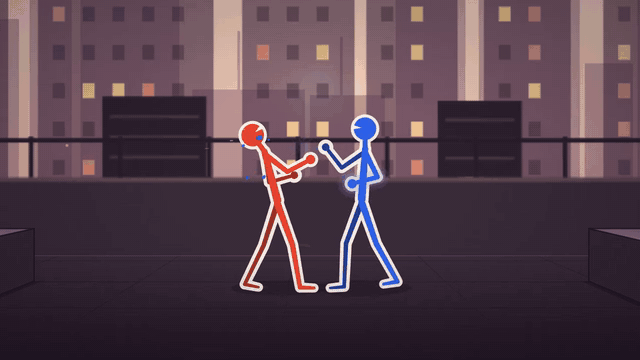
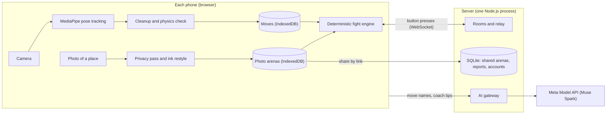

# SticXcape

A stick-figure fighting game where your own body writes the move list. Record punches, kicks and taunts with your phone's camera, then fight a friend with them, in an arena made from a photo of a real place.



**Play the staging build:** https://sticxcape-staging.malaysiawest.cloudapp.azure.com. It plays best on a phone held sideways. Practise against a bot on your own, or start a room and send the invite link to a friend.

## What's in it

- **Move Studio.** Perform a move in front of the camera, and pose tracking (MediaPipe, on the phone) turns it into a stick-man move. The cleanup smooths each joint, fits the game's skeleton, locks planted feet and caps limb speed, and a physics check keeps every joint within what a body can do. Recording starts by itself once you're fully in frame, alone, with clear space around you. Without a camera, a demo take goes through the same cleanup.
- **The fight.** A loadout is nine moves: two lights, two heavies, a low, a special, a defense move, a taunt and a victory pose. Any place you haven't recorded uses the default moveset. You can block, parry (tap block just before a hit lands), grab and throw. The engine is deterministic, so two phones given the same button presses play out the same fight. A practice bot plays at three levels.
- **Friend rooms.** Create a room and share the link. The phones send only their button presses, through a WebSocket relay on the server, and the relay checks every second that both phones agree on the fight. When more than two people are in a room, the winner stays on.
- **Photo arenas.** Snap a real place and fight in it. Before anything else looks at the photo, a privacy pass on the phone smears out people and pixelates faces, screens and documents. Sofas, benches, chairs, beds and tables standing on the floor become ledges you can jump onto. An ink-wash restyle makes every photo fit the game. Arenas stay on your phone until you share one by link, and friend rooms can fight in shared arenas.
- **Meta AI (Muse Spark).** It names your moves from their keyframes, and coaches you with two tips after each match. Before a shared arena reaches friends, it checks the arena's name and backdrop. Every call goes through the server, so the API key never reaches a phone, and the game uses its own names and tips when the AI is unavailable.
- **Safety and your data.** The game asks once that players are 13 or older, and online matches end with Report and Block. Settings → Your data backs up and restores your moves, and can delete everything the game keeps on the phone.
- **Built, but not switched on in the game yet:**
  - Rollback netcode: it's in the netcode module, and the engine can save and load its state for it. Online fights use input delay for now.
  - Passkey accounts with a cloud move library.
  - Quick match against strangers, with signed moves and Muse Spark checks of nicknames, taunts and victory poses.

## How it works



The design is written up in four PRDs in [plan/](plan/):

| File | What it covers |
| --- | --- |
| [01-product-prd.md](plan/01-product-prd.md) | What we build and why: gameplay, game feel, look and sound, Meta AI use, roadmap, parked ideas |
| [02-frontend-prd.md](plan/02-frontend-prd.md) | The phone web app: modules, screens, technical rules, week-by-week plan |
| [03-backend-prd.md](plan/03-backend-prd.md) | The services: rooms, relay, AI gateway, security, week-by-week plan |
| [04-integration-prd.md](plan/04-integration-prd.md) | The contract between them: file formats, messages, API, tests, definition of done |

Diagrams are in [plan/images/](plan/images/). The PRDs were exported on 2026-11-03 from the [live doc](https://claude.ai/artifact/92awHCKr9eSbJmi1h5ofwj), which is still where they're edited and commented on. Progress is tracked in the [Frontend PRD](plan/02-frontend-prd.md#progress) and the [Backend PRD](plan/03-backend-prd.md#progress).

## Code

| Folder | What it is |
| --- | --- |
| [apps/client](apps/client/src/main.ts) | The game: Move Studio, photo arenas, the deterministic fight engine, renderer, sound and every screen |
| [apps/client/scripts](apps/client/scripts/bot-opponent.ts) | A practice bot that joins a room through the relay and fights with the game's engine |
| [packages/shared](packages/shared/src/index.ts) | The contract in code: file formats, messages, HTTP API, button bits, input-delay rule, fixed-point maths |
| [packages/netcode](packages/netcode/src/index.ts) | The client's netcode (input delay and rollback), plus a fake relay and canned AI for working offline |
| [services/server](services/server/src/app.ts) | The services in one Node.js process: web hosting, rooms, relay, AI gateway, accounts, shared arenas, reports, metrics |
| [services/server/lab](services/server/lab/main.ts) | The relay lab at `/lab/`: a toy match between two phones through the relay |
| [services/server/scripts](services/server/scripts/bots.ts) | Bot matches for the 50-match, bad-network and load checks, and the lab build |
| [deploy/azure](deploy/azure/README.md) | Staging on one Azure VM: first-boot setup, Compose file and deploy script |

## Run it locally

You need Node.js 22.18 or later, which runs TypeScript directly (on Windows: `winget install OpenJS.NodeJS.LTS`).

```bash
npm install
```

```bash
npm run dev
```

```bash
npm run dev:client
```

`npm run dev` starts the server on port 8080. `npm run dev:client` serves the game on port 5173 and forwards rooms, the relay, AI calls, arena sharing and reports to the server. Open http://localhost:5173.

Practice fights and Move Studio work without the server. Rooms, shared arenas, move names and coach tips need it. For live Meta AI, copy [services/server/.env.example](services/server/.env.example) to `services/server/.env` and set `MODEL_API_KEY`. Without a key, move names and tips are canned answers.

**Controls on a computer:**
- A and D (or ← and →) walk, W jumps, and S crouches.
- J is light, K heavy, L special and I defense. J with K grabs.
- Space blocks; tap it just before a hit lands to parry.
- Esc or P pauses. Gamepads work too.

On phones, an on-screen stick and buttons appear. Settings has one-thumb layouts for either hand, and an Arrange screen to drag the buttons where your thumbs rest.

**Fighting online from one computer:** create a room in the browser, and let a bot join it with its invite link (`--level` takes easy, normal or hard):

```bash
node --conditions=source apps/client/scripts/bot-opponent.ts <invite link> --level hard
```

Both sides run the same engine, and the relay compares their state every second. So a finished match also shows that the browser and Node agree.

**On a phone:** the camera needs HTTPS, so Move Studio and photo arenas need the staging build or a tunnel. On the same Wi-Fi, `http://<your computer's address>:5173` is enough for fights and rooms. For the camera, build everything, serve the game from the server, and open it through a tunnel such as `cloudflared tunnel --url http://localhost:8080`:

```bash
npm run build
```

```bash
WEB_ROOT=../../apps/client/dist TRUST_PROXY=1 npm start
```

`WEB_ROOT` is relative to `services/server`, where the server runs.

## Check it

```bash
npm run typecheck
```

```bash
npm test
```

The tests cover the shared contract, the netcode, the server (including real matches through the relay over WebSockets) and the game's engine, cleanup, photo arenas and privacy features.

With the server running, `npm run bots` plays bot matches through it in real time:

```bash
npm run bots -- --rooms 10 --matches 5
```

```bash
npm run bots -- --latency 100 --jitter 20
```

- The first is the 50-match check: no desync and no relay error allowed.
- The second plays over a bad network, with 100 ms more round trip between the phones. `--rollback` plays with rollback netcode instead.
- `--rooms 200` is a load test. Start that server with `MAX_CONNECTIONS_PER_IP=1000 ROOMS_PER_IP_PER_10_MIN=1000`.
- On Windows, timers tick every 15.6 ms, so added delays come out longer than asked; the bots print the round trip they measured.
- `npm run bots -- --help` lists every option.

## Staging and deploys

Staging runs on one small Azure VM in Malaysia West, with Caddy in front for HTTPS. Deploys are done by hand: merging to `main` doesn't deploy anything. From the repository root, in Git Bash:

```bash
bash deploy/azure/deploy.sh
```

It copies the committed state to the VM, builds the [Docker image](Dockerfile) there and restarts the server. Open rooms reset, while accounts, shared arenas and reports stay on the VM's disk. [deploy/azure/README.md](deploy/azure/README.md) covers the secrets, logs, costs, and how the VM was made.

[CI](.github/workflows/ci.yml) runs on pushes to `main` and `backend-mvp` and on every pull request. It typechecks, runs the tests and builds everything. It plays bot matches through the built server, including rollback matches on a slow network, and smoke-tests the Docker image.
