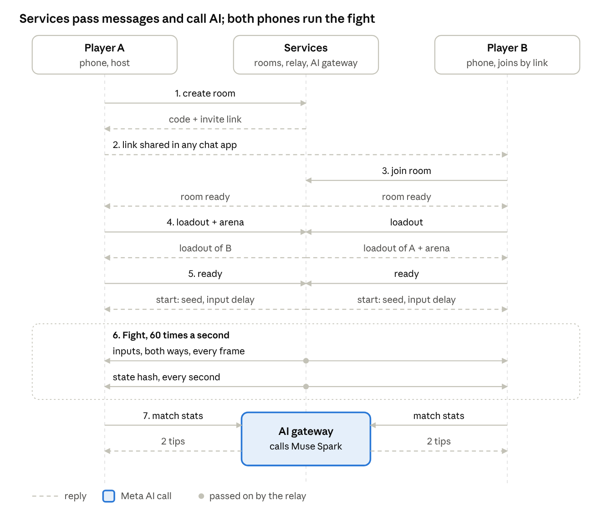

# Integration PRD: contracts and end-to-end

Part of the SticXcape PRD set: [Product](01-product-prd.md) · [Frontend](02-frontend-prd.md) · [Backend](03-backend-prd.md) · **Integration**

## Purpose and ownership

This file is the contract between the game client and the services. If both sides build against it, they can work in parallel from day 1 using mocks, and joining them in week 3 is a check rather than a rewrite. It is frozen at the end of week 1; later changes need both owners to agree.

Most MVP work happens on the phone, so the backend owner also takes online play end to end, including the client's netcode module. That keeps the two workloads close.

| Area | Owner | Also involved |
| --- | --- | --- |
| Fight engine, rendering, sound, screens | Frontend | None |
| Move Studio and cleanup | Frontend | None |
| Online play: netcode client and relay | Backend | Frontend (fight engine hooks) |
| Room links and lobby | Backend | Frontend (room screen) |
| AI gateway and prompts | Backend | Frontend (shows names and tips) |
| Move and arena file formats | Frontend | Backend (validates and signs at launch) |
| Shared types package | Both | None |
| End-to-end tests | Backend | Frontend (runs them on phones) |

## One match, end to end

The relay never runs the fight: it only passes loadouts, inputs and state hashes between the phones, and a mismatched hash ends the match as a desync. The only AI call in a match is the 2 tips at the end.

## Data contracts

Two file formats cross the boundary: moves (recorded on a phone, sent to the opponent, stored in the cloud at launch) and arenas (bundled in the MVP, made by the photo pipeline at launch). Both carry a version number so either side can reject a format it doesn't know.

### Move file (version 1)

| Field | Type | Meaning |
| --- | --- | --- |
| id | Text (UUID) | Unique move ID |
| version | Number | Format version; 1 for the MVP |
| slot | light, heavy, low, special, defense, taunt or victory | Sets damage and timing |
| name | Text | The player's or Meta AI's name for the move |
| frames | Base64 of 16-bit values | 60 per second; each frame is the root position plus 17 joint angles in fixed point |
| active | First and last frame | When the striking limb can hit |
| limb | Joint name | The striking limb, such as the right wrist |
| height | high, mid or low | Auto-tagged from where the strike lands |
| hash | Text | SHA-256 of the fields above; both phones compare it before a match |
| signature | Text | Added by the server at launch |

A 3-second move is about 9 KB, so a full loadout stays under about 50 KB.

### Arena file (version 1)

| Field | Type | Meaning |
| --- | --- | --- |
| id | Text | Unique arena ID |
| version | Number | Format version; 1 for the MVP |
| name | Text | Display name |
| layers | List of image URLs | Background and foreground art, back to front |
| floor | Number | Height of the floor line, in metres from the bottom |
| width | Number | Playable width in metres |
| spawns | Two x positions | Where the fighters start |
| ledges | List of x, y and width | Platforms (launch) |
| edges | Wall or drop, left and right | Drops allow ring-outs (launch) |

Official arenas ship inside the app. The photo pipeline produces exactly this format at launch, so the client needs no new code to show photo arenas.

## Message contracts

### Room messages (WebSocket, JSON in the MVP)

| Message | Sent by | Fields | What happens |
| --- | --- | --- | --- |
| join | Phone | room, nickname, clientVersion | Relay adds the player and replies with their player number and whether they host, or an error |
| loadout | Phone | moves | Relay passes it to the other player |
| arena | Host | arenaId | Relay passes it on. A photo arena (a UUID id) must be shared and is for friend rooms only |
| ready | Phone | rollback (optional, launch) | When both are ready, the relay sends start |
| start | Relay | seed, inputDelay, startFrame, fighters, arenaId, rollback | Both phones begin on the same frame |
| input | Phone | frame, buttons | Relay passes it on immediately |
| hash | Phone | frame, stateHash | Sent every 60 frames; a mismatch ends the match as a desync |
| sync | Phone | lateness | Rollback matches only: relay passes it on; the phone running ahead slows down |
| end | Phone | winner | Relay closes the match; stats go to the AI gateway separately |
| ping and pong | Both | time | Measures round-trip time |
| quickmatch | Phone | nickname | Launch, signed in: relay checks the nickname, answers queued, and pairs the phone with a stranger |
| cancelmatch | Phone | None | Stops a quick match search |
| leave | Phone | None | Leaves the room, keeping the connection |
| queued | Relay | None | The phone is in the quick match queue |
| matched | Relay | opponent (id, nickname) | Paired: sent after joined puts the phone in a new two-player room |

**Buttons** are a 9-bit field: 4 bits for the stick direction, 5 for L, H, S, D and Block. **Input delay** is 3 frames (50 ms) when ping is under 80 ms and up to 6 frames above that, set once at start.

**Quick match (launch, MP-7)** pairs signed-in players on a hidden skill rating and ping, starting within 100 points and 100 ms and widening each second. Its rooms hold two players and take only loadouts of moves the server has signed (`POST /account/moves/sign`). Finished matches move both players' ratings, and leaving one counts as a loss. Strangers see a nickname only after Muse Spark has checked it; otherwise it reads Challenger.

**Rollback (launch, MP-6)** is used for a match only when both phones send `rollback: true` with ready; `start` then has `rollback: 8`. Input delay drops to 2 frames (33 ms), and grows only past about 260 ms between the phones, so a phone never rewinds more than 8 frames. A phone plays frames on a guess of the opponent's input and replays them when the real input differs. It sends a state hash only once that frame's inputs are final, and reports the winner only once the deciding frame is final.

### HTTP API

| Call | Body | Returns | Errors |
| --- | --- | --- | --- |
| POST /rooms | nickname | code, link | 429: too many rooms |
| GET /rooms/{code} | None | exists, players, arena | 404: not found or expired |
| POST /ai/move-name | slot, limb, height, peakSpeed, 3 keyframe images | name, description | 429 or 503: the client uses a default name |
| POST /ai/match-tips | Per-move stats | tips (exactly 2) | 503: no tips shown |
| GET /version | None | Lowest supported clientVersion | None |

All calls use HTTPS and reply in JSON. A version mismatch on join tells the phone to reload the web app.

**Accounts and the cloud move library (launch, MP-9).** Signing in is optional: guests keep playing with the moves on their phone. Players sign up and sign in with a passkey (Face ID, a fingerprint or the phone's PIN), and the sign-in is an HttpOnly cookie, so these calls must come from the game's own origin.

| Call | Body | Returns | Errors |
| --- | --- | --- | --- |
| GET /account | None | account (or null), passkeys (whether this server and page can use them) | None |
| POST /account/passkey/register/options | name (the nickname) | ceremony, WebAuthn creation options | 400: bad name; 429; 503: accounts off, or not on HTTPS with a domain |
| POST /account/passkey/register | ceremony, credential | account, plus the sign-in cookie | 400: expired ceremony or refused passkey; 409: passkey already registered |
| POST /account/passkey/login/options | None | ceremony, WebAuthn request options | 429; 503 |
| POST /account/passkey/login | ceremony, credential | account, plus the sign-in cookie | 400: expired ceremony; 401: unknown or refused passkey |
| POST /account/logout | None | account: null | None |
| DELETE /account | None | Nothing (204); the account, its sign-ins and library are deleted | 401: not signed in |
| POST /account/moves/sign | moves (1 to 16) | moves, each with a signature | 400: malformed, hash mismatch, or outside the move rules (says which move and why) |
| GET /account/blocks | None | players (id, name, blockedAt) | 401 |
| POST /account/blocks | player (account id) | Nothing (204); never matched again, either way round | 404: no such player |
| DELETE /account/blocks/{id} | None | Nothing (204) | 404: not blocked |
| POST /account/reports | player, reason (name, moves, cheating or other), note (optional, 300 characters) | reported: true | 404: no such player; 429: over 20 a day |

**Shared photo arenas and room reports (launch, AR-4, AR-5, AR-7).** The phone makes photo arenas itself; these share finished ones with friends and take reports from friend rooms. They send the phone's `X-Player-Id` and need no sign-in.

| Call | Body | Returns | Errors |
| --- | --- | --- | --- |
| POST /arenas | Multipart: file (arena JSON whose only layer is `photo:{id}`), image (JPEG, 160 to 2048 px a side, at most 1.5 MB), palette (6 colours) | 201 id, link (`/a/{id}`); 200 when that phone already shared it | 400: malformed, `name_blocked` or `image_blocked`; 409: id taken or 30 shared already; 429: 10 an hour per network; 503: `check_unavailable` |
| GET /arenas/{id} | None | file, imageUrl, palette | 404: not shared or deleted |
| GET /arenas/{id}/image | None | The JPEG backdrop | 404 |
| DELETE /arenas/{id} | None (same X-Player-Id) | Nothing (204) | 404: not that phone's |
| POST /reports | nickname, reason (name, moves, cheating or other), room (or null), at | 202 | 400; 429: over 20 a day per phone; 503: try again later |

A friend room can fight in a shared photo arena. The host's `arena` message names it; the relay refuses it with `arena_not_shared` unless it is shared, and with `arena_friends_only` in quick match. Every phone loads it from `GET /arenas/{id}` before getting ready. A shared arena never changes, so all of them fight in the same one. If it is deleted before the match starts, the relay puts the room back on the default arena (`arenaId` null) and tells both fighters.
| GET /account/library | None | moves (move, kind, description, quality, createdAt, updatedAt), loadout | 401 |
| PUT /account/library/moves/{id} | move, kind (move or idle), description, quality, createdAt | updatedAt | 400: malformed or hash mismatch; 409: library full (200 moves) |
| DELETE /account/library/moves/{id} | None | Nothing (204) | 404: not in the library |
| PUT /account/library/loadout | loadout: place (such as light1) to move id | loadout | 400 |

## Shared code and environments

**One shared TypeScript package** holds the move and arena file types, every message type, the button bit layout, the input-delay rule and the fixed-point maths. The client and the services both import it, so a change in one place breaks both builds until they agree.

**Mocks until week 2.** Before the relay and gateway are live, the client runs against a fake relay that plays back its own inputs as the opponent, and canned AI names and tips.

| Environment | Who uses it | Notes |
| --- | --- | --- |
| Local | Developers | One laptop runs both sides. Phones on the same Wi-Fi still need HTTPS for the camera, so use a local HTTPS tunnel |
| Staging | Team and playtesters | Real Meta API with a test key and low rate limits; reset weekly |
| Production | Players, from launch | Its own API key, monitoring and alerts |

## Integration plan and tests

| Week | Integration milestone |
| --- | --- |
| 1 | Contracts in this file frozen; shared package published; client runs on mocks; rooms and an echo relay live on staging |
| 2 | Two phones fight through the staging relay on the same Wi-Fi; move names come from Muse Spark |
| 3 | The full flow on staging (link, room, fight, results, tips) on iPhone and Android, over Wi-Fi and mobile data |

**Tests**

- **Determinism.** Replay 20 recorded input logs on Safari on iPhone and Chrome on Android; state hashes must match at every check.
- **Cross-device matches.** iPhone against Android, Wi-Fi against mobile data.
- **Bad networks.** Add 50, 100 and 150 ms of delay with jitter; matches stay playable up to 100 ms.
- **AI down.** Block Meta's API: names and tips fall back, and matches still run.
- **Load.** The staging relay handles the beta's expected peak of rooms plus 50% without added delay.

**Definition of done for the MVP**

- [ ] The full flow works on staging on iPhone and Android
- [ ] 50 test matches in a row with no desync
- [ ] Every finished match shows 2 tips, or the fallback when the API is down
- [ ] The product PRD's week-3 check is met: friends play 10+ matches and ask for rematches
